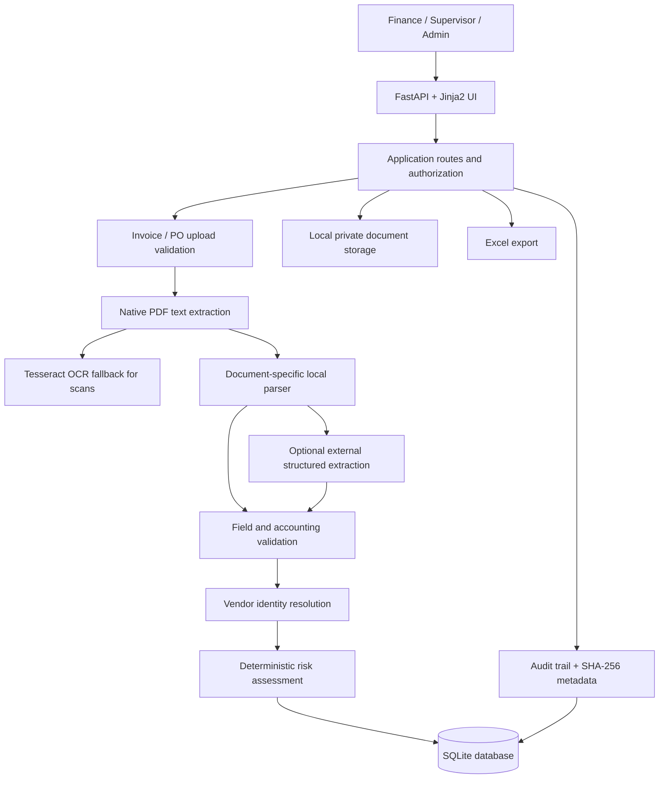

# Sentrion — SME Invoice Operations & Financial Risk MVP

Sentrion is a student-built prototype for small-business finance workflows, with an initial focus on F&B ingredient distributors. It helps finance teams process supplier invoices and purchase orders (POs), inspect extracted information, identify discrepancies, resolve vendor identities, and route decisions through role-based human review.

> **Safety boundary:** Sentrion is a prototype, not banking software. It does not connect to a bank or transfer real money. Payments are simulated, and AI/OCR output cannot independently authorize an invoice or execute a payment.

## Submission information

- **Competition track:** International Track — “AI as a Financial Participant”
- **Relevant topic:** Topic E — SME Finance Copilot
- **Repository URL:** `TODO: insert the public GitHub repository URL before submission`
- **Build represented by this archive:** local Sentrion MVP with vendor-resolution and PO-relinking revision
- **Hosted demo URL:** no verified hosted deployment is included in this archive
- **Demo environment:** local SQLite sandbox

The International Track submission checklist requests technical documentation, a presentation of no more than 10 minutes, source code with a README/GitHub link/deployment instructions/test cases, a security self-assessment, and execution evidence for simulated-account/sandbox operation. The demo video is listed as optional (up to 5 minutes) in the checklist. This README documents the current build; it does not replace the presentation or execution evidence.

Before submission, replace the repository placeholder above and verify that the public repository contains the same source revision as this archive.

## What Sentrion does

- Authenticates users with `finance`, `supervisor`, and `admin` roles.
- Provides an English-language dashboard, invoice queue, search, automatic filters, invoice review, and audit views.
- Accepts invoice and PO documents in PDF, PNG, and JPEG formats, with validation and upload-size limits.
- Extracts document text from digital PDFs and uses Tesseract OCR for scanned pages/images when available.
- Supports local, pattern-based extraction and optional structured extraction through an OpenAI-compatible Chat Completions endpoint. External AI is disabled by default.
- Presents extraction status separately from processing-job status. `PARTIAL` means processing may have finished while required fields still need review.
- Stores supplier/vendor records, historical payment destinations, POs, and line items.
- Performs deterministic risk checks and classifies cases as GREEN, YELLOW, or RED.
- Supports manual correction and verification, approval/rejection workflows, bank-account-change requests with dual control, and a limited controlled resolution path for eligible PO-total mismatches.
- Uses deterministic vendor-resolution rules, including exact normalized tax-ID matching against eligible verified vendors; name-only matches require authorized review, and conflicting reliable tax IDs remain a high-risk identity issue.
- Can reconcile previously uploaded unlinked POs after a vendor becomes verified, with an audit record and risk reassessment.
- Provides a PO detail page with extracted supplier identity, vendor link status, financial breakdown, line items, extraction provenance, protected document access, and audit history.
- Supports simulated payments, audit events, SHA-256 document hashes, and Excel export.

## Architecture



### Main components

- `app/main.py` — FastAPI routes, request handling, authorization checks, UI pages, and upload workflows.
- `app/config.py` — local environment configuration and data paths.
- `app/db.py` — SQLite schema, initialization, and safe forward migrations.
- `app/security.py` — session/authentication helpers and password hashing.
- `app/services/extraction.py` — native-text/OCR processing and deterministic extraction rules.
- `app/services/llm_extraction.py` — optional external structured extraction, bounded timeout/retry behavior, and sanitized traceability.
- `app/services/processing.py` — document-processing workflow.
- `app/services/vendor_resolution.py` — vendor identity classification, controlled PO/vendor linking, reconciliation, and audit events.
- `app/services/risk.py` — risk findings, invoice/PO consistency checks, and risk-level determination.
- `app/services/audit.py` — audit event helpers.
- `app/services/exporter.py` — Excel report generation.
- `app/templates/` and `app/static/` — Jinja2 templates, CSS, and JavaScript.
- `tests/` — automated regression tests using an isolated test database.

## Core algorithms and business rules

### Document extraction

1. Validate the file format, file signature, and configured upload-size limit.
2. Extract native text from digital PDFs where usable.
3. Use PDF rendering and Tesseract OCR when the text layer is absent or insufficient, provided the OCR binary and language data are installed.
4. Parse invoice and PO documents separately, using document labels, identifiers, money fields, and line-item layouts.
5. Validate structured fields and preserve missing or uncertain values for review rather than silently inventing values.
6. External LLM extraction is optional and disabled by default. If enabled, its structured response is not trusted blindly and does not control risk classification or payment authorization.

Extraction status can be `QUEUED`, `PROCESSING`, `COMPLETED`, `PARTIAL`, or `FAILED`. A completed processing job does not mean every extracted field is correct; reviewers must inspect incomplete or conflicting fields.

### Vendor identity resolution and PO relinking

- A unique exact normalized tax-ID match against an eligible verified vendor is the primary basis for automatic linking.
- Exact normalized company-name matches without reliable matching tax IDs are candidates and require authorized review; they do not automatically establish trusted identity.
- Conflicting reliable tax IDs must not be automatically linked, even when company names are similar.
- A supplier identity printed on a PO is stored separately from the trusted vendor-master relationship.
- After a vendor finishes the required approval process, Sentrion can reconcile previously uploaded unlinked POs. Only eligible exact tax-ID matches are automatically linked by this reconciliation.
- Relinking is designed to be idempotent. Related invoices are reassessed; resolved prior findings are retained as `SUPERSEDED` history, while unrelated findings remain active.
- Manual PO/vendor linking is permission-restricted and requires a reason. A successful vendor link does not itself approve the invoice or authorize payment.

### Financial and risk validation

- Invoice and PO monetary fields are compared only when values are sufficiently available and currencies are compatible.
- The application distinguishes extracted values from derived calculations and missing/conflicting data where supported.
- `GREEN` indicates that required checks are available and no finding reaches the configured escalation threshold; personnel approval is still required.
- `YELLOW` indicates that verification or manual review remains necessary.
- `RED` indicates a high-risk condition requiring investigation and blocking standard approval/payment paths.
- A risk level is a decision-support result, not proof of fraud.
- Initial thresholds are demonstration policies, not universal accounting rules. They must be reviewed against the business's accounting and approval policy before any real-world use.

## Security design and limitations

- **Role-based access:** separate Finance, Supervisor, and Admin permissions are enforced in server-side routes. Hiding a control in the UI is not the authorization boundary.
- **Authentication:** password hashes and session-based authentication are used for the local prototype. Local demo credentials must never be reused on a public deployment.
- **CSRF protection:** state-changing forms use CSRF tokens.
- **Vendor onboarding:** submission creates a pending request, not an active trusted vendor. Vendor identity and bank-account evidence must be reviewed, the maker cannot approve their own request, and distinct personnel complete the approval stages.
- **Bank-account changes:** independent evidence and separate approvals are required; account numbers are masked in the normal UI and general audit/export views.
- **PO relinking:** exact tax-ID matches can be linked under the documented eligibility rules. Ambiguous or conflicting identities require review; identity conflict remains high-risk.
- **Document handling:** uploads are type/size checked and stored outside public static paths. Evidence records include hash/metadata and are checked for integrity when reviewed. Access to documents is routed through authenticated handlers.
- **Auditability:** significant operations generate audit events. SHA-256 hashes support integrity comparison; they do not make the local database immutable or tamper-proof.
- **LLM safety:** external AI is off by default. When enabled, extracted document text is sent to the configured provider. Provider output can be wrong, and documents may contain malicious instructions; model output cannot authorize payments.
- **Payments:** no bank integration exists. Payments are simulated only.

The competition also requires a separate security self-assessment report. That file was not present in the supplied source archive; include the final, reviewed report in the repository before submission and ensure its claims match the actual code and tests.

## Requirements

- Python 3.11 or newer.
- Tesseract OCR installed and accessible on `PATH` for scanned PDFs/images. Digital PDF text extraction may work without Tesseract, but scanned documents need OCR.
- Internet access for first-time Python dependency installation. No external AI API key is required for local-only mode.

### Windows one-click setup

1. Extract the complete `Sentrion_MVP_Revised` directory to a normal writable folder.
2. Double-click `SETUP_AND_RUN.bat`.
3. The script checks Python 3.11+, creates/reuses a shared virtual environment under `%LOCALAPPDATA%\Sentrion`, installs requirements only when needed, checks Tesseract, prepares `.env` if it does not exist, starts the server, and opens the browser.
4. Open <http://127.0.0.1:8000> if the browser does not open automatically.
5. Keep the separate **Sentrion Server** console open while using the application. Press `Ctrl+C` in that console to stop the server.

The setup script preserves an existing `.env` and reuses the dependency cache. If OCR installation is not available, the app may start but scan/image processing may be incomplete.

### Manual setup — Windows PowerShell

Run these commands from the directory containing `app/main.py`:

```powershell
py -3 -m venv .venv
.\.venv\Scripts\Activate.ps1
python -m pip install -r requirements.txt
Copy-Item .env.example .env
```

Edit `.env` and replace `SENTRION_SESSION_SECRET` with a long random secret. Keep external AI disabled unless its use has been approved for the data being processed.

Start the application:

```powershell
python -m uvicorn app.main:app --host 127.0.0.1 --port 8000
```

Open <http://127.0.0.1:8000>.

### Manual setup — macOS/Linux

```bash
python3.11 -m venv .venv
source .venv/bin/activate
python -m pip install -r requirements.txt
cp .env.example .env
```

Edit `.env` to replace the session secret, then run:

```bash
python -m uvicorn app.main:app --host 127.0.0.1 --port 8000
```

Open <http://127.0.0.1:8000>.

### Configuration

The application reads `.env` from the project root. Environment variables already present in the process take precedence over `.env` values.

| Variable | Purpose | Local default |
|---|---|---|
| `SENTRION_SESSION_SECRET` | Session signing secret | Generated by Windows setup if `.env` is created there; replace manually otherwise |
| `SENTRION_HTTPS_ONLY` | Secure-cookie behavior behind HTTPS | `false` for localhost only |
| `SENTRION_MAX_UPLOAD_MB` | Upload size limit in MB | `10` |
| `SENTRION_DEFAULT_CURRENCY` | Configured fallback currency when document evidence is insufficient | `USD` |
| `SENTRION_DATA_DIR` | Local data and private upload directory | `./data` |
| `SENTRION_DB_PATH` | SQLite database file path | `./data/sentrion.db` |
| `SENTRION_ENABLE_EXTERNAL_AI` | Enable optional external structured extraction | `false` |
| `OPENAI_API_KEY` | API key for the configured compatible provider | empty |
| `OPENAI_BASE_URL` | OpenAI-compatible API base URL | `https://api.openai.com/v1` |
| `OPENAI_MODEL` | Configured model identifier | `gpt-4.1-mini` |
| `SENTRION_AI_TIMEOUT_SECONDS` | Per-request timeout | `12` |
| `SENTRION_AI_TOTAL_BUDGET_SECONDS` | Total time budget for provider attempts | `24` |
| `SENTRION_AI_MAX_RETRIES` | Bounded retry count | `1` |

For Google Gemini, configure the OpenAI-compatible endpoint and model supported by the provider. Do not assume that setting the base URL alone validates the integration. Real provider behavior must be tested separately. Use synthetic documents unless data sharing with the provider is authorized.

## Local demo accounts

These are seed accounts for **local testing only**:

| Role | Email | Password |
|---|---|---|
| Finance Staff | `finance@sentrion.local` | `FinanceDemo!2026` |
| Supervisor | `supervisor@sentrion.local` | `SupervisorDemo!2026` |
| Administrator | `admin@sentrion.local` | `AdminDemo!2026` |

Do not expose these credentials on a public service or reuse them outside the local demo. Change the credentials before any shared demonstration environment.

## Reproducible demo workflow

1. Sign in as Finance Staff and open **Invoices**.
2. Review a GREEN example and inspect its field data, active findings, and verification status.
3. Review the new-bank-account example to observe a YELLOW hold.
4. Review the prompt-injection and PO-total-mismatch examples to observe RED risk controls.
5. Upload `examples/invoices/01_invoice_green.pdf` to exercise digital-PDF extraction.
6. Upload `examples/invoices/05_invoice_scanned_yellow.png` to exercise image OCR (requires Tesseract).
7. Upload `examples/invoices/03_invoice_red_prompt_injection.pdf` to demonstrate that document instructions do not authorize actions. Avoid duplicate invoice numbers when reproducing the scenario.
8. Open **Purchase Orders**, inspect an existing PO, and open its detail page.
9. Test vendor onboarding with synthetic identity and bank-account evidence. Use separate users for submission, first review, and final approval.
10. For vendor relinking, start with a controlled QA PO whose extracted tax ID matches an eligible verified vendor. Run refresh/reconciliation and inspect the persisted link, audit event, and reassessed invoice findings. Do not use an ambiguous name match as identity proof.
11. Export the Excel report from the relevant invoice/audit page.

The files in `examples/` and test fixtures are synthetic. Some examples intentionally contain inconsistent values to exercise controls.

## Tests and quality checks

Install development requirements:

```bash
python -m pip install -r requirements-dev.txt
```

Run the automated test suite:

```bash
python -m pytest -q
```

Run compilation checks:

```bash
python -m compileall -q app tools_*.py tests
```

The automated suite is organized into seven test modules:

- `tests/test_currency.py` — currency handling and monetary parsing.
- `tests/test_db_migrations.py` — SQLite migration compatibility and preservation of existing records.
- `tests/test_extraction_risk.py` — document parsing, extraction behavior, and risk findings.
- `tests/test_llm_traceability.py` — optional-provider response handling, sanitized traceability, and local fallback behavior.
- `tests/test_revision_features.py` — regression coverage for the recent extraction, PO-detail, and financial-validation revisions.
- `tests/test_vendor_resolution.py` — vendor identity resolution, PO relinking, idempotency, and related risk-history behavior.
- `tests/test_web_workflows.py` — authenticated web workflows, role permissions, approvals, uploads, and audit-facing behavior.

Tests use an isolated database fixture; do not point local tests at a production database. For scenario-level details and manual UI evidence, see [`docs/test-cases/TEST_CASES.md`](docs/test-cases/TEST_CASES.md).

**Verification recorded while preparing this README:** `71 passed` from `python -m pytest -q`, and Python compilation completed successfully on the supplied archive. Re-run both commands on the final submission commit and preserve the terminal output as execution evidence.

## Test cases and execution evidence

The submission includes both **automated regression tests** and **manual UI test-case evidence**. These are separate evidence types and should not be counted interchangeably.

### Automated regression tests

Run `python -m pytest -q` and `python -m compileall -q app tools_*.py tests` as described above. The verification recorded for the source archive documented by this README was **71 pytest tests passed** and a successful Python compilation check. Re-run the commands against the exact final submission commit and preserve the sanitized terminal output.

### Manual UI test cases and screenshots

The team-provided `Test Case.zip` contains local-demo screenshots of registered-vendor and unregistered-vendor workflows. They cover the following visible scenarios:

| Test ID | Scenario | Visible evidence |
|---|---|---|
| UI-01 | Dashboard with registered-vendor test records | [Dashboard screenshot](docs/test-cases/screenshots/registered_vendors_dashboard.png) |
| UI-02 | GREEN invoice — Northstar; invoice fields, PO, line items, bank destination, and document hash | [Invoice summary](docs/test-cases/screenshots/registered_vendor_01_green_invoice_summary.png) · [PO/line items/hash](docs/test-cases/screenshots/registered_vendor_01_payment_po_line_items_hash.png) |
| UI-03 | GREEN invoice — Harborview Packaging | [Invoice summary](docs/test-cases/screenshots/registered_vendor_02_green_invoice_summary.png) |
| UI-04 | YELLOW invoice — financial discrepancy / verification required | [Invoice summary](docs/test-cases/screenshots/registered_vendor_03_yellow_verification_summary.png) |
| UI-05 | RED invoice — AI-directed prompt injection and hard block | [Finding and hard block](docs/test-cases/screenshots/registered_vendor_04_prompt_injection_finding_and_hard_block.png) |
| UI-06 | YELLOW invoice — payment destination not verified | [Finding and PO match](docs/test-cases/screenshots/registered_vendor_05_bank_destination_finding_po_and_hash.png) |
| UI-07 | Invoice from a supplier not present in the trusted vendor master | [Extracted fields](docs/test-cases/screenshots/unregistered_vendor_01_invoice_fields_no_trusted_match.png) · [Vendor/PO findings](docs/test-cases/screenshots/unregistered_vendor_01_vendor_and_po_not_found_findings.png) |
| UI-08 | Additional unregistered supplier scenarios | [Vendor 2](docs/test-cases/screenshots/unregistered_vendor_02_view_1.png) · [Vendor 3](docs/test-cases/screenshots/unregistered_vendor_03_view_1.png) |
| UI-09 | Dashboard state for unregistered supplier examples | [Dashboard screenshot](docs/test-cases/screenshots/unregistered_vendors_dashboard.png) |

See [`docs/test-cases/TEST_CASES.md`](docs/test-cases/TEST_CASES.md) for preconditions, steps, expected behavior, limitations, and a retest checklist. See [`docs/test-cases/TEST_CASE_MATRIX.csv`](docs/test-cases/TEST_CASE_MATRIX.csv) for the structured test matrix. [`docs/test-cases/SCREENSHOT_INDEX.csv`](docs/test-cases/SCREENSHOT_INDEX.csv) maps original screenshot filenames to the normalized evidence filenames.

**Evidence caveat:** the screenshots show UI states from the local demo; the ZIP does not include executable Playwright scripts or a test-run log. A screenshot alone does not prove that every action sequence was rerun on the final submission commit. Reproduce the cases in an isolated local SQLite sandbox and record the actual result (`PASS`, `FAIL`, `BLOCKED`, or `NOT RUN`) before using them as fresh execution evidence. The bank-destination mismatch screenshot shows **YELLOW / verification required** in this build; do not describe it as RED unless the implementation and a retest demonstrate that status.

## Deployment instructions and deployment status

### Current build status

This archive is a **local SQLite prototype**. The vendor-link schema migration in `app/db.py` is SQLite-specific. The application stores the database and uploaded files on the local filesystem. This exact archive has not been deployed to Vercel, and this README does not claim a verified hosted deployment.

### Local demo deployment

For a reproducible judge/reviewer demonstration, use the Windows one-click setup or the manual setup instructions above. The service binds to `127.0.0.1:8000` and can be tested on the same machine.

### Private persistent-host deployment (guidance, not verified for this archive)

A controlled single-instance Linux VM can run the FastAPI app if it has a persistent writable disk for the SQLite database and uploaded documents:

1. Install Python 3.11+, Tesseract OCR, and the OS libraries required by the Python dependencies.
2. Clone the repository and create a virtual environment; install `requirements.txt`.
3. Configure a protected environment file outside version control. Set a strong random `SENTRION_SESSION_SECRET`, `SENTRION_HTTPS_ONLY=true` behind HTTPS, `SENTRION_ENABLE_EXTERNAL_AI=false` unless explicitly approved, and absolute persistent paths for `SENTRION_DATA_DIR` and `SENTRION_DB_PATH`.
4. Ensure the service account can write only to the required application data directory. Keep `.env`, the SQLite database, uploaded documents, and backups out of the public web root and out of Git.
5. Run the app under a service manager, using a command such as `python -m uvicorn app.main:app --host 127.0.0.1 --port 8000` without `--reload`.
6. Put a properly configured HTTPS reverse proxy in front of the application, limit access to authorized users, configure backups and log retention, and test uploads, private document access, role permissions, session cookies, and recovery before allowing a shared demo.
7. Re-run all tests against the exact deployed commit and keep sanitized execution evidence.

These steps are deployment guidance, not evidence that a public host or production configuration has been validated. Do not deploy this SQLite build directly to serverless platforms such as Vercel as-is: local file persistence and the SQLite-specific migration are not a validated production persistence architecture. A hosted deployment needs a separately reviewed database/storage design, platform-specific migration, secrets configuration, and deployment smoke tests.

## Repository structure

```text
Sentrion_MVP_Revised/
  app/
    main.py
    config.py
    db.py
    security.py
    seed.py
    ui_text.py
    services/
      extraction.py
      llm_extraction.py
      processing.py
      vendor_resolution.py
      risk.py
      audit.py
      exporter.py
    templates/
    static/
  data/                     # runtime database/uploads; keep out of public releases
  examples/                 # synthetic invoice and PO examples
  tests/                    # automated regression tests and fixtures
  docs/test-cases/           # manual UI test cases, matrix, screenshot evidence
  SECURITY_SELF_ASSESSMENT.md # permission tiers, controls, residual risks
  requirements.txt
  requirements-dev.txt
  .env.example
  SETUP_AND_RUN.bat
  README.md
```

## Known limitations

- This is a prototype for a controlled demonstration, not production financial software or a claim of regulatory compliance.
- OCR and deterministic extraction can fail on unfamiliar layouts, low-quality scans, handwritten material, or conflicting fields. Human review remains necessary.
- External provider timeouts, rate limits, endpoint compatibility, and output quality depend on the selected provider. Offline tests do not establish live Gemini reliability.
- Prompt-injection detection uses heuristics and cannot guarantee detection of every malicious instruction.
- Vendor identity inferred from a document is not independent verification. Bank ownership is not confirmed by a bank integration.
- The application does not match invoices to goods-receipt records and does not execute real payments.
- Risk thresholds are demo settings and require business validation.
- The local SQLite audit trail is not immutable or tamper-proof.
- This archive has not been deployed to a live hosted environment.

## Integrity and licensing

The competition rules require entries to be completed independently and third-party data, code, and open-source components to be properly licensed. The sample documents bundled with Sentrion are synthetic. Review the licenses of the dependencies listed in `requirements.txt` and `requirements-dev.txt` and any third-party assets before public submission; this README is not a substitute for a formal license audit. No separate license for the Sentrion source code is declared by this archive; do not assume the source is released under an open-source license unless the team deliberately adds one.
